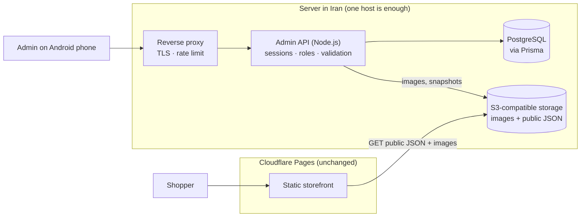

# Admin & product-management architecture

Status: **tested foundation, nothing deployed.** No cloud resource exists, no paid service is enabled, and the public site and its Cloudflare Pages deployment are untouched.

This revision replaces the earlier Cloudflare-centred proposal (D1, R2, Workers, Access) with a **portable, self-hostable design** that follows the owner's decisions below.

## 1. Decisions and how the design follows them

| Decision | How it is applied |
|---|---|
| Production server hosted **in Iran** | A plain Node.js server + PostgreSQL + S3-compatible storage, deployable on any Linux host. No dependency on a foreign cloud for the admin system. |
| **PostgreSQL** is the production database | Prisma 7 + PostgreSQL schema and migrations (`prisma/`). Verified against a real PostgreSQL 16 server and an embedded PostgreSQL. |
| **Portable S3-compatible** image storage | `ObjectStorage` port with an S3 adapter (MinIO, Ceph, or any provider that speaks the S3 API); no provider-specific features. |
| **No budget** for paid cloud services | Everything is open source and runs on one server; development and tests need no cloud account at all (embedded PostgreSQL, local disk, in-memory fakes). |
| Only **Claude Pro**, no paid AI API | Nothing in the product calls an AI API or needs an API key. Claude Code is used for development only. |
| Cloudflare Pages **storefront must stay up** | Untouched: same static export, same workflow. The storefront only ever reads public files; see §7. |

## 2. Architecture



* The **admin API** is the only component that writes. It is not part of the public site and is reached only through the reverse proxy.
* **Shoppers never reach the API or the database.** They read sanitised, published-only JSON and images from the object store (§7).

### Ports and adapters

The application depends on small interfaces; each has a production adapter and a no-cloud adapter for development and tests.

| Port (interface) | Production adapter | Development / test adapters | Swap-in candidates |
|---|---|---|---|
| `CatalogRepository` (`src/domain/product/ports.ts`) | `PrismaCatalogRepository` → PostgreSQL | same code on **embedded PostgreSQL** (PGlite) | any SQL database with a new adapter |
| `AdminStore` (`server/auth/ports.ts`) | `PrismaAdminStore` → PostgreSQL | `MemoryAdminStore` (same contract tests) | LDAP/SSO-backed store |
| `ObjectStorage` (`src/domain/product/ports.ts`) | `S3Storage` (any S3 API) | `LocalDiskStorage` (dev), `MemoryStorage` (tests) | any object store |
| `Authenticator` (`server/auth/ports.ts`) | `SessionAuthenticator` (cookie + server-side session) | same | an OIDC/SSO authenticator (e.g. a self-hosted Keycloak) |
| `PasswordHasher` | `ScryptHasher` (Node built-in) | same, lower cost in tests | Argon2 |

Layout:

```
src/domain/        framework-free logic shared by the admin UI (browser) and the server:
                   product rules, validation, Persian utilities, CSV, query parsing, snapshot format, ports
server/            Node.js admin API
  api.ts             router: session → Origin → CSRF → role → handler
  auth/              passwords, TOTP, sessions, rate limiting, stores
  catalog/           Prisma repository, service (slugs, publish validation), snapshot publisher
  storage/           S3, local disk, memory
  db/                Prisma client, embedded PostgreSQL, test database helper
  config.ts          environment configuration with fail-fast validation
  main.ts, cli/      server entry point and the administrator CLI
prisma/            schema + SQL migrations (the production data model)
```

### What was kept and what was removed

* **Kept (unchanged behaviour, tests preserved):** product model and validation, Persian utilities, CSV import/export, query parsing, public snapshot format, image validation.
* **Replaced:** the D1/SQLite repository → Prisma/PostgreSQL; the R2 bucket interface → S3 interface; Cloudflare Access JWT verification → built-in authentication; the Worker router → a Node HTTP server with the same routes.
* **Removed:** `workers/`, the Wrangler template and the Cloudflare setup guide. Nothing in the repository depends on a Cloudflare service except the already-existing Pages deployment.
* **Improved on the way** (found by the tests): a search bug where a lone `_` or `%` matched every product (ORMs do not escape LIKE wildcards; they are now stripped from search terms), and prices were first limited to 2,000,000,000 Toman (PostgreSQL `INTEGER`); that limit has since been replaced by the BIGINT model in §3.

## 3. Product model

### Price model (BIGINT, reviewed)

Prices are integer **Toman** (never floats). `null` price = "not announced".

**Review of the earlier 2,000,000,000 Toman limit.** It came from PostgreSQL's 32-bit `INTEGER`, not from any business rule. It is too low for the long run: with inflation, a handmade carpet, a set of orders or an order *total* can exceed 2 billion Toman, and rial-denominated imports (×10) would hit it immediately. The limit was therefore removed:

| Layer | Representation | Why |
|---|---|---|
| Database (`priceToman`, `unitPriceToman`, `totalToman`) | **`BIGINT`** (Prisma `BigInt`) | no practical ceiling; `CHECK` constraints keep prices within `0 … 10¹⁵` and make a negative value impossible even if the application is bypassed |
| Application / API / JSON / snapshots | JavaScript `number`, validated as a safe integer in `0 … MAX_TOMAN = 1,000,000,000,000,000` (10¹⁵ Toman) | 10¹⁵ < 2⁵³ ≈ 9.007×10¹⁵, so every allowed price is represented **exactly** in JSON and by `JSON.parse` in any browser; no `BigInt` ever reaches `JSON.stringify` (which would throw) |
| Order totals | computed in `BigInt` (`lineTotal`, `sumToman` in `src/domain/money.ts`), then converted back with a range check | `price × quantity` and the sum of many lines can exceed 2⁵³ before they exceed the limit; an out-of-range total is rejected (`order_total_out_of_range`) instead of silently losing precision |
| Conversion | only at the repository boundary (`tomanToDb`, `tomanFromDb`) | one place to audit; a value above `MAX_TOMAN` coming from the database (manual edit) raises an error rather than being shown wrong |
| Display | `formatToman` / `formatNumber` accept `number | bigint` and use `Intl.NumberFormat("fa-IR")`, which is exact for both | tested up to 2⁶³−1 |

10¹⁵ Toman is far beyond any handmade-goods price; if a real need ever appears, raising `MAX_TOMAN` requires representing money as strings or `BigInt` end-to-end in the API and snapshots (a deliberate, versioned change) — the database already allows it.

Where it is enforced and tested: product/variant schemas, list-filter bounds (`minPrice`/`maxPrice`), CSV import/export (large values, Persian digits and separators, quoting), the HTTP API end to end (create → read → list/filter → public snapshot with a 10¹⁵ price), the repository (`BIGINT` round-trip, database `CHECK`), orders (exact totals above 2⁵³ in intermediate steps), and `formatToman`.

| Fulfilment | Meaning | Inventory | Lead time | Variants |
|---|---|---|---|---|
| `unique` | one-of-a-kind handmade piece | 0 or 1 (defaults to 1; 0 = sold) | not allowed | **not allowed** |
| `stocked` | made in advance | required (on product, or on every variant) | not allowed | allowed |
| `made_to_order` | produced after the order | not allowed | **required** (days) | allowed (no stock) |

* **Status:** `draft` → `published` → `archived`, any direction. Publishing re-validates: a category, ≥ 1 image and a price (or a price on every variant).
* **Variants:** 1–3 named options (size, colour…), unique SKU, optional price override, own inventory; all variants of a product use the same option names; max 50.
* **Images:** up to 12, ordered, first is the cover; stored as `images/<productId>/<uuid>.<jpg|png|webp>`.
* **Concurrency:** updates carry the `version` they read; a stale write gets `409` instead of overwriting (phone + laptop, two admins). Concurrent writers: exactly one wins (tested).
* **Audit log:** every write records who did what, in the same transaction.
* **Database safety net:** `CHECK` constraints reject negative prices/stock, stock on made-to-order products and unique pieces with stock other than 0/1, even if application code were bypassed (tested).

## 4. PostgreSQL + Prisma

* **Schema** (`prisma/schema.prisma`) mirrors the domain model: `Product`, `ProductImage`, `ProductVariant`, `Category`, `AdminUser`, `AdminSession`, `AuditLog`, `Vendor` (multi-vendor ready), and — added in the second foundation step — customers (`Customer`, `CustomerOtp`, `CustomerSession`, `Address`, `Favorite`, `CustomerDataRequest`), orders (`Order`, `OrderItem`), support (`SupportTicket`, `SupportMessage`, `SupportNote`, `FaqCategory`, `FaqItem`) and maintenance (`Incident`, `IncidentUpdate`, `BackupRecord`, `ErrorReport`, `MaintenanceLog`). The old placeholder `User`/`VendorMember` models were dropped (no data existed). Enums are lower-case so the API and database share the same strings.
* **Migrations** (`prisma/migrations`): `…_init` is generated from the schema; `…_constraints` adds `CHECK` constraints Prisma cannot express; `…_customers_support_maintenance` (hand-ordered after generation) and `…_constraints_v2` add the BIGINT prices, the new tables, their `CHECK`s and the partial unique index that allows one default address per customer. `prisma migrate diff` reports no drift between schema and migrations (also checked in CI). Production applies them with `npx prisma migrate deploy` (verified on a real PostgreSQL 16).
* **Driver:** Prisma 7's `pg` adapter, so any PostgreSQL works (self-hosted, managed, embedded). Connection pooling by `pg`; use PgBouncer only if you ever run many instances.
* **Search:** normalised Persian text in `searchText` with `contains` (SQL `LIKE`). Comfortable into the tens of thousands of products. Beyond that add a trigram index (not applied automatically):
  ```sql
  CREATE EXTENSION IF NOT EXISTS pg_trgm;
  CREATE INDEX products_search_trgm ON products USING gin ("searchText" gin_trgm_ops);
  ```
* **Persian sorting:** "sort by name" uses the database collation. Create the database with an ICU Persian collation for correct alphabetical order (PostgreSQL 15+, verify for your version): `CREATE DATABASE jaryan TEMPLATE template0 ENCODING UTF8 LOCALE_PROVIDER icu ICU_LOCALE 'fa-IR';`.
* **Backups:** `pg_dump` on a schedule plus an off-server copy; see [SELF-HOSTING.md](SELF-HOSTING.md).

## 5. Object storage (S3-compatible)

* One bucket, two prefixes: `images/…` (uploaded images) and `catalog/…` (public JSON snapshots). Public read is granted on those prefixes by bucket policy or the CDN/proxy in front; **never store private files in this bucket**.
* Image keys are unguessable UUIDs, so unpublished product photos are not discoverable; uploads accept only jpeg/png/webp by magic bytes (SVG/HTML rejected), ≤ 5 MB, and are resized on the phone before upload.
* Options (decision for the owner): **MinIO** on the same server (open source, no extra cost, simplest), or an **S3-compatible service from an Iranian provider** (offloads storage and backups; evaluate terms and price yourself; this repo makes no claim about any provider). Because only the S3 API is used, you can start with one and move later by copying the bucket.

## 6. Administrator authentication

There is no external identity provider dependency. The server implements it, with every layer testable offline, and **no fake or bypass authentication exists** (the development-only `DEV_ADMIN_*` bootstrap is refused in production).

| Layer | Implementation |
|---|---|
| Accounts | Created only by the CLI on the server (`npm run admin -- create`). No public sign-up, no default account. |
| Password | scrypt (N = 2^17, about 128 MiB per hash, OWASP guidance), per-user salt, parameters stored in the hash so they can be raised later (upgraded at next login); at most 2 hashes at once to bound memory. Policy: ≥ 12 characters, not derived from the email, not on a small common list. |
| Second factor | **TOTP mandatory** (RFC 6238; works with any authenticator app); verified against the RFC test vectors; a code can never be used twice (atomic replay protection); the secret is encrypted at rest (AES-256-GCM) with a key that lives only in the server environment. Lost phone → `reset-totp` on the server. |
| Sessions | Random 256-bit token in an `HttpOnly; Secure; SameSite=Strict` cookie (`__Host-` prefix); **only the token's SHA-256 is stored**. Idle timeout 2 h, absolute 12 h (configurable), revoked on logout, password change/reset, disable. |
| CSRF | State-changing requests need an allow-listed `Origin` **and** the session's CSRF token in `X-CSRF-Token` (compared in constant time). Empty allow-list ⇒ all writes refused. |
| Brute force | Per-IP and per-email rate limits; account lock after 5 consecutive failures (15 min), wrong TOTP codes count too; identical answers and equal hashing work for unknown emails (no account enumeration by content or timing). Add proxy-level limits for defence in depth (see SELF-HOSTING). |
| Authorisation | Roles `owner` / `editor` / `viewer` checked on every route (matrix tested). |
| Audit | Logins (success/failure/lock), password/TOTP resets and every catalogue write are recorded. |

Limits to know: the rate limiter is in memory (correct for one server process; use the proxy's limits or a shared store if you ever run several); the administrator list is tiny, so scrypt cost per login is acceptable.

## 7. How the storefront gets live product data, securely

The static storefront stays on Cloudflare Pages. Live data comes from **published snapshots**: public JSON files the admin API writes to the object store after every change.

```
catalog/manifest.json                 categories + counts + version      (cache ~30 s)
catalog/categories/<slug>.json        product cards of one category      (cache ~60 s)
catalog/products/<slug>.json          full public product                (cache ~60 s)
images/<productId>/<uuid>.webp        product images                     (immutable)
```

* **No server on the read path:** shoppers read static files from the bucket/CDN; the database and the admin API are never exposed to them and cannot be overloaded by shopper traffic.
* **No credentials in the browser:** the storefront only needs one public URL (`NEXT_PUBLIC_CATALOG_URL`).
* **Sanitised by construction:** the snapshot type has no ids, status, stock counts, versions or edit times, only `published` products are written, and tests fail if an internal field leaks. Unpublishing deletes the file and refreshes the shard and manifest.
* **No site rebuild per edit:** snapshots refresh within about a minute; Pages' deploy quota is never touched.
* **Failure isolation:** a storage outage never fails an admin request (it is logged and can be repaired with `POST /api/v1/catalog/resync`); verified against a dead S3 endpoint.

### How the storefront consumes it (implemented)

Cloudflare Pages serves a **static** export, so "publish → customers see it" cannot depend on a rebuild. The storefront therefore reads the snapshots **in the visitor's browser** (`src/lib/live-catalog.ts`, `src/components/live/`):

* `NEXT_PUBLIC_CATALOG_URL` (a **public** value, https or loopback http; set as a GitHub repository *variable*, picked up by `cloudflare-pages.yml`) is the base URL under which `catalog/…` and `images/…` are served. Unset = the site keeps its labelled sample content (unchanged behaviour).
* Home page: the "آثار" section loads `manifest.json` + the category shards and shows published cards (real image, name, price, "از" for variant ranges, availability badge). Empty catalogue, loading and unreachable store each have their own plain message; sample products are never shown in this mode.
* `/product?slug=<slug>`: one static page that loads `catalog/products/<slug>.json` (images, price, description, variants with price and availability, lead time). A slug with no file (draft, archived, unknown, or an invalid/path-like slug) is "not in the store". It is `noindex`: its content exists only at view time. Crawlable HTML stays the job of the build-time path below.
* Everything read is validated with the same zod schemas as the build-time reader (`src/domain/product/snapshot-schema.ts`); image URLs must be http(s)/relative; a malformed file is an error, never a half-rendered page.
* **Draft and archived products never appear** because they have no file: the publisher deletes the product file and rebuilds the category shard and manifest when a product leaves `published` (or is renamed or moved). The storefront has nothing to filter.
* **Freshness:** the admin writes the snapshot right after the change; the manifest is cached ~30 s and product files ~60 s (`Cache-Control` set by the publisher), so customers see a change within about a minute without any deployment.

**What still needs real infrastructure (not part of this repository's tests):** a public bucket/CDN holding `catalog/` and `images/` with **CORS allowing the storefront origin on GET, including for 404 responses** (browsers hide a CORS-less 404 behind a network error, which the storefront would show as "unreachable"); the admin API running somewhere with `STORAGE_DRIVER=s3` and `PUBLIC_MEDIA_URL` pointing at that bucket; and the repository variable `NEXT_PUBLIC_CATALOG_URL` set to its base URL, followed by one normal Pages deployment to bake it in. The browser-side reader works from wherever the visitor is (including Iran) as long as the bucket is reachable from them.

**Cart and checkout on the same live data.** The storefront also has a cart, a checkout and order pages (details in [CUSTOMERS.md §8](../customers/CUSTOMERS.md)). The cart holds only product, variant and quantity; every price and availability comes from the snapshots above, and the server re-checks everything from the database when an order is placed. `NEXT_PUBLIC_ORDER_API_URL` (public) is the base URL of the customer API; without it the checkout is a clearly labelled demo that creates no order. The browser calls only `/api/v1/customer` from one file (`src/lib/order-api.ts`); `server/invariants.test.ts` fails if any storefront file references an admin API path.

Optionally, `CATALOG_SNAPSHOT_URL` / `CATALOG_SNAPSHOT_DIR` make the *build* also read the snapshot to generate crawlable `/products/<slug>` and `/category/<slug>` pages and the sitemap (SEO; see docs/seo). Those pages reflect the catalogue as of the last build; the live layer above keeps the shopper-facing pages current in between. Build-time reads depend on GitHub's runners being able to reach the bucket (some Iranian hosts block foreign IPs), so verify that before relying on them.

Tested end to end (`admin/e2e/storefront-publish.e2e.ts`, CI "Admin PWA"): real PostgreSQL 16, the real admin UI, the real static storefront build made once before anything is published and served like Pages serves it, a customer's phone browser. Draft invisible → publish visible with its real image and price → edit with variants and a sold-out size → back to draft gone → publish → archive gone, all without rebuilding the storefront.

Open question for the owner (§11): the storefront is served from Cloudflare, the data from Iran. This works for visitors who can reach both; if you later want the whole site in Iran, the same static export (`out/`) can simply be served by the reverse proxy: no code change.

## 8. Local development and tests without any cloud service

```bash
npm install
npm test                  # 224 tests; embedded PostgreSQL + in-memory fakes, no services, no credentials
npm run api:dev           # API on http://127.0.0.1:3001 with embedded PostgreSQL in .data/ and local media storage
```

For a first administrator in development: `DEV_ADMIN_EMAIL=you@example.com DEV_ADMIN_PASSWORD='a long passphrase' npm run api:dev` (development only; TOTP is optional there). To exercise the production-like flow, stop the dev server and use `npm run admin -- create …`.

Optional: run the same tests against a real PostgreSQL by setting `TEST_DATABASE_URL` (each test file uses its own throw-away schema).

## 8b. Customers, support and maintenance (second foundation step)

Same ports-and-adapters style; each area is documented on its own:

* [Customer accounts](../customers/CUSTOMERS.md) — phone + one-time-code sign-in, sessions, addresses, favourites, order history, export, deletion; pluggable SMS (none active).
* [Customer support](../support/SUPPORT.md) — tickets, conversations, internal notes, roles, abuse protection, Persian FAQ.
* [Technical maintenance](../maintenance/MAINTENANCE.md) — health, incidents, security checks, error reports, encrypted backups with a *verified* restore test, maintenance audit log, free CI automation.

Code layout added: `src/domain/{money,phone}.ts`, `src/domain/{customer,support,maintenance}/` (pure rules and Zod schemas, shared with the browser), `server/customers/`, `server/support/`, `server/maintenance/`, `server/sms/`, `server/routes/` (admin route modules plugged into `createApi({ adminRoutes })`), `server/customer-api.ts` (separate public/customer handler: own cookie, CORS allow-list, CSRF), `server/services.ts` (wiring shared by the server, the CLIs and the tests), `server/cli/ops.ts`. Administrator RBAC gained support, FAQ, customer and maintenance actions (`server/auth/rbac.ts`).

## 9. Costs and constraints

| Item | Cost | Note |
|---|---|---|
| Software (Node.js, PostgreSQL, MinIO, nginx, Prisma, all libraries) | **free / open source** | |
| TLS certificate | free options exist | issuance depends on what is reachable from Iran |
| GitHub Actions + Cloudflare Pages (existing deployment) | free tier, unchanged | |
| **Server in Iran** | the only recurring cost | A small VPS is enough to start (2 vCPU, 4 GB RAM): scrypt uses ~128 MiB per concurrent login and PostgreSQL a few hundred MB. Storage grows with images (≈ 1.5 GB per 1,000 products at ~250 KB × 6 photos). |
| SMS gateway (customer sign-in) | **not activated** | The only new cost driver. Bounded by `SMS_DAILY_LIMIT` (default 300 codes/day for the whole site). Customer sign-in is off in production until the owner chooses and configures a provider. |
| Monitoring and security automation | free | GitHub Actions workflows only; no paid service. |
| AI services | **none** | The product never calls an AI API. |

## 10. Security considerations

| Threat | Mitigation |
|---|---|
| Public access to admin functions | Separate hostname behind the reverse proxy; every API route requires a session; nothing admin-related is in the static site (verified: no admin code in `out/`). |
| Credential/secret leakage | Secrets only in the server environment file (mode 0600); config errors never print values; logs record error *names* only (tested); DB dumps do not reveal TOTP seeds (encrypted); passwords/sessions only as hashes. |
| Stolen database or backup | Password hashes (scrypt), session token hashes, encrypted TOTP seeds. |
| CSRF / cross-site requests | Origin allow-list + CSRF token + `SameSite=Strict`. |
| SQL injection | Prisma parameterised queries only (no raw SQL in the catalogue code); tested with hostile input. |
| Malicious uploads | Magic-byte type detection (jpeg/png/webp), declared type must match, 5 MB cap, random keys, `nosniff`. |
| CSV formula injection | `=`, `+`, `-`, `@` neutralised on export, reversed on import. |
| Information leakage via snapshots | Dedicated public type + leak tests + published-only. |
| Lost updates / races | Version check; one winner under concurrency; image limit enforced under concurrent uploads. |
| Brute force, enumeration | Rate limits, lockout, uniform responses, mandatory TOTP with replay protection. |
| Dependency risk | Small surface: `zod`, `pg`, Prisma, the AWS S3 client (storage only); everything else is Node built-ins. |

## 11. Remaining decisions for the owner

1. **Server hosting in Iran:** which provider and plan; OS (Ubuntu LTS is assumed); who administers it and takes backups.
2. **Object storage:** MinIO on the same server, or an S3-compatible service from a provider; and its public URL/CDN.
3. **Domains and TLS:** admin hostname (e.g. `admin.<domain>`), media hostname, how certificates are issued.
4. **Storefront reachability:** keep the Cloudflare Pages storefront as is, or additionally serve the static export from Iran; confirm the storefront can reach the Iranian media URL (CORS, HTTPS).
5. **Administrators:** names, roles, and who holds the authenticator devices; password-manager policy.
6. **Backup and recovery policy:** frequency, retention, off-server copy, restore drill.
7. **Product data:** final categories and attributes (dimensions, materials), and the first real catalogue.
8. **SMS provider:** which Iranian gateway, its API format and price; sender number/regulatory registration; the daily limit you accept.
9. **Legal text and retention:** terms and privacy policy wording; how long order/accounting data must be kept after an account is deleted.
10. **Customer-facing policies** for the FAQ: delivery times, returns, made-to-order lead times (the FAQ drafts are empty on purpose).
11. **Next build steps:** the mobile-first admin UI, then the customer UI (sign-in, account, support), then checkout/payment (PRD Phase 3) — separate PRs.
