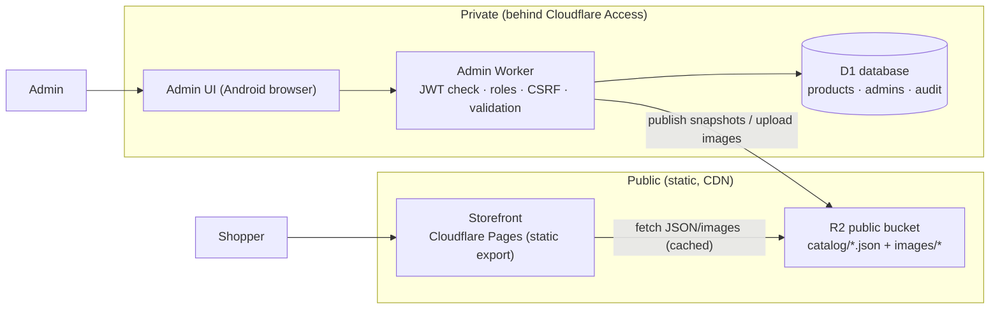

# Admin & product-management architecture

Status: **proposal + tested foundation.** Nothing here is deployed, no cloud resource has been created, and no paid service is enabled. Section 12 lists what needs the owner's approval.

## 1. Recommendation (TL;DR)

| Concern | Recommendation |
|---|---|
| Storefront | Keep the current **static Next.js export on Cloudflare Pages** (unchanged). |
| System of record | **Cloudflare D1** (SQLite) behind a small **admin Worker**. |
| Images | **Cloudflare R2**, public bucket on a custom domain; phones resize images before upload. |
| Live data for the storefront | The admin Worker publishes **sanitised JSON snapshots to R2**; the storefront reads them from the CDN. Shoppers never reach D1 or a Worker. |
| Admin authentication | **Cloudflare Access** (identity provider + MFA, no passwords in our code) **plus** full JWT verification in the Worker, an admin allow-list table with roles, Origin checks (CSRF) and an audit log. |
| Admin UI | A separate mobile-first app served by the **same Worker** (same origin, no CORS), behind Access. Not part of the public site. |
| Bulk import/export | CSV parsed **in the admin's browser**, sent to the server in small validated chunks. |

Why this shape: it is the cheapest option that scales to thousands of products (everything fits in free tiers at that size, see §10), has no always-on server, keeps all admin power off the public site, and leaves the production website and its deployment workflow untouched.

## 2. What is built in this PR

| Piece | Where | Status |
|---|---|---|
| Persian utilities (digits, Arabic→Persian letters, search normalisation, Toman parsing, slugs) | `src/domain/persian.ts` | implemented, tested |
| Product model + validation (unique / stocked / made-to-order, variants, images, publish rules) + Persian messages | `src/domain/product/schema.ts`, `messages.fa.ts` | implemented, tested |
| Search/filter/sort/pagination query + parameterised SQL | `src/domain/product/query.ts` | implemented, tested (incl. 1,500-product test) |
| CSV import/export (injection-safe, row-numbered errors) | `src/domain/product/csv.ts` | implemented, tested |
| Public snapshot format (no internal fields) | `src/domain/product/snapshot.ts` | implemented, tested |
| Image validation (magic bytes, size, key scheme) | `src/domain/images.ts` | implemented, tested |
| D1 schema | `workers/admin-api/migrations/0001_init.sql` | implemented, exercised by tests on real SQLite |
| Repository (CRUD, optimistic concurrency, import, audit) | `workers/admin-api/src/repository.ts` | implemented, tested |
| Access JWT verification, roles, CSRF/Origin, size limits | `workers/admin-api/src/auth`, `http.ts` | implemented, tested with real RSA signatures |
| Admin API router + snapshot publisher | `workers/admin-api/src/index.ts`, `publisher.ts` | implemented, tested end-to-end (fake R2, in-memory D1) |
| Cloudflare config template | `workers/admin-api/wrangler.toml.example` | template only |
| **Admin UI**, CSV upload screen, real deployment | — | **not built / not deployed** (needs approval, §12) |

The public site is not changed. No admin code is imported by any page, and the static output contains none of it. The Pages workflow still deploys only `out/`.



## 3. Product model

Prices are integer **Toman** (never floats). `null` price = "not announced".

| Fulfilment | Meaning | Inventory | Lead time | Variants |
|---|---|---|---|---|
| `unique` | one-of-a-kind handmade piece | 0 or 1 (defaults to 1; 0 = sold) | not allowed | **not allowed** |
| `stocked` | made in advance | required (on product, or on every variant) | not allowed | allowed |
| `made_to_order` | produced after the order | not allowed | **required** (days) | allowed (no stock) |

* **Status:** `draft` → `published` → `archived`, any direction. Publishing re-validates: needs a category, ≥ 1 image and a price (or a price on every variant). Drafts can be incomplete.
* **Variants:** 1–3 named options (e.g. size, colour), unique SKU, optional price override, own inventory. All variants of a product use the same option names. Max 50.
* **Images:** up to 12, ordered; first is the cover. Stored as R2 keys `images/<productId>/<uuid>.<jpg|png|webp>`.
* **Categories:** flat or one level of parent; products reference one category.
* **Concurrency:** every update carries the `version` it read; a stale write gets `409 version_conflict` instead of silently overwriting (two admins, or phone + laptop).
* **Audit log:** who created/updated/uploaded what, in the same transaction as the change.

## 4. Search, filter, CSV

* Search normalises Persian text on both sides (Arabic ي/ك → ی/ک, Persian/Arabic digits → ASCII, ZWNJ and diacritics removed), so «ديوار», «دیوار» and «۱۲» / «12» match. Terms are AND-ed; user text is always a bound parameter and LIKE wildcards are escaped.
* Filters: status (archived hidden by default), category, fulfilment, availability, price range; sort by updated/created/name/price; pages of ≤ 100.
* Today search is `LIKE` over a normalised column, fine for thousands of rows. If the catalogue grows well beyond ~10–20k products, move to D1's FTS5 (same normalisation) without changing the API.
* The list query pages ids first and only then looks up cover/variant data for that page. This keeps D1 "rows read" (metered) low.
* CSV format: see [CSV-FORMAT.md](CSV-FORMAT.md). Parsing/validation runs in the browser; the server re-validates each chunk (default 10 products per request, sized for the free plan), and a chunk is all-or-nothing. Exports page through the JSON list API and build the CSV in the browser. Formula-injection (`=`, `+`, `-`, `@`) is neutralised on export and reversed on import.

## 5. Evaluation: Cloudflare D1

| | |
|---|---|
| **Fit** | SQLite semantics, transactional `batch()`, no server to run, scales to our size with room to spare. Reads/writes are metered per row. |
| **Limits that shaped the code** (Cloudflare docs, checked for this PR) | Free: 5M rows read/day, 100k rows written/day, 5 GB total storage, 500 MB per database, 10 databases. **50 queries per invocation on Free (1,000 on Paid)**; one `batch()` counts as **one** query. **100 bound parameters** per query. |
| **How the code copes** | Writes use a single transactional batch; import chunks are small; the list endpoint pages ids first; shard/manifest rebuilds can be deferred to one call after a multi-chunk import. |
| **Strengths** | Zero ops, point-in-time recovery ("Time Travel"), cheap, sits next to the Worker. |
| **Weaknesses / risks** | Single-region primary (latency from Iran to the nearest Cloudflare location is fine for an admin tool). 500 MB/DB on Free is plenty for catalogue text but not for images (those go to R2). No cross-database transactions. Vendor lock-in to Cloudflare. |
| **Verdict** | **Recommended** for the catalogue + admin data. |
| **Alternative** | Managed PostgreSQL (the repo's existing Prisma schema). Better if you later need heavy relational reporting, but it adds a server/connection layer, a monthly bill and a public attack surface. Keep it as the fallback; the domain layer is database-agnostic. |

The Prisma/PostgreSQL schema in `prisma/schema.prisma` remains the *reference model* until the D1 decision is approved. If approved it can be retired; if not, the domain/validation/CSV/snapshot code is reusable on any database.

## 6. Evaluation: Cloudflare R2

| | |
|---|---|
| **Fit** | S3-compatible object store; **no egress fees**; public bucket on a custom domain served through Cloudflare's CDN. |
| **Free tier / prices** (Cloudflare docs) | 10 GB-month storage, 1M Class A (write) and 10M Class B (read) operations per month free; then $0.015/GB-month, $4.50 per million Class A, $0.36 per million Class B. |
| **Capacity** | 1,000 products × ~6 images × ~250 KB (phone-resized WebP) ≈ 1.5 GB. Even 5,000 products stays under the free 10 GB. |
| **Strengths** | Cheap at any size, CDN-cached reads (cache hits do not even count as bucket operations), simple Worker binding. |
| **Weaknesses / risks** | No built-in resizing: we resize in the admin's browser before upload (≤ 5 MB enforced server-side). Cloudflare Images/Transformations would add resizing but is a separate paid/metered product and is **not** enabled. Enabling R2 may require a payment method on file even for the free tier (reported by third-party guides; confirm in the dashboard). |
| **Verdict** | **Recommended** for images and public snapshots. |
| **Alternatives** | Cloudflare Images (paid, extra features); an Iran-based S3-compatible object store (worth evaluating if Cloudflare billing is not possible for the owner or for lower latency inside Iran); committing images to the repo (does not scale and would hit Pages' 20,000-file and 500-deploys/month limits). The code talks to a tiny bucket interface, so the storage backend can be swapped. |

## 7. How the static storefront gets live product data, securely

The storefront stays a static export (fast, cheap, nothing to attack). Live data comes from **published snapshots**: public, immutable-style JSON files in R2, written by the admin Worker.

```
catalog/manifest.json                 categories + counts + version      (cache ~30 s)
catalog/categories/<slug>.json        product cards of one category      (cache ~60 s)
catalog/products/<slug>.json          full public product                (cache ~60 s)
images/<productId>/<uuid>.webp        product images                     (immutable)
```

Why this instead of a public API in front of D1:

* **No server on the read path.** Shopper traffic hits the CDN, not a Worker or D1, so it cannot exhaust the 100,000 requests/day Worker quota or D1's daily row limits, and an attack on it cannot reach the database.
* **No credentials in the browser.** The storefront only reads public files; there is nothing to leak. `NEXT_PUBLIC_*` variables hold just the public bucket URL.
* **Sanitised by construction.** The snapshot type contains only what shoppers may see: no ids, status, exact stock counts, versions, edit timestamps or internal notes. A test fails the build if an internal field leaks. Only `published` products are ever written; unpublishing or archiving deletes the file and refreshes the shard and manifest.
* **No rebuild per edit.** Pages allows 500 deploys/month on Free, so redeploying the site on every product change is not viable. Snapshots update within about a minute of an admin action.

How pages consume it (a later PR; not wired today):

1. **Browsing and detail pages** fetch snapshots at **build time** for crawlable HTML (SEO), and re-validate in the browser on load for fresh price/availability. A scheduled daily rebuild (1 deploy/day) keeps the static HTML reasonably current.
2. **Search across the catalogue** loads the category shards (cards are small) and filters on the client; for very large catalogues add a small public search Worker later (it would be read-only and rate-limited).
3. **Failure mode:** if the bucket is unreachable the site falls back to the build-time data it shipped with. Never to an error page.

Hardening of the public side: R2 bucket only ever contains public data (never put originals or private files in it); image keys are unguessable UUIDs, so unpublished product photos are not discoverable; CORS on the bucket limited to the storefront origin; Cloudflare cache rules + WAF rate limiting on the custom domain; SVG and other active content are rejected at upload.

## 8. Administrator authentication and authorisation

**No passwords, no home-grown login, no "fake" auth anywhere in this code.** Without correct Cloudflare configuration the admin API returns `503 admin_not_configured` and serves nothing.

Layers (all must pass):

1. **Cloudflare Access** in front of the admin hostname performs the sign-in with your identity provider (Google, GitHub, or one-time PIN by email), enforces MFA if the provider does, and applies a short session lifetime. Only listed emails can even reach the Worker.
2. **Token verification in the Worker** (defence in depth, in case the Access policy is ever misconfigured or the Worker is reached directly): RS256 signature checked against the team's published keys selected by `kid` (re-fetched once on rotation), issuer = your team domain, audience = this application's AUD tag, expiry/not-before with 30 s leeway. `alg: none` and HMAC "algorithm confusion" are rejected. The team domain must match `*.cloudflareaccess.com`.
3. **Allow-list + roles** in D1 (`admins` table: `owner`, `editor`, `viewer`, `disabled`). A valid Access user who is not enabled in the table gets `403`. There is **no default admin**: the first owner is inserted manually once ([CLOUDFLARE-SETUP.md](CLOUDFLARE-SETUP.md)).
   * `viewer`: read only. `editor`: create/edit/publish/import/upload/categories/resync. `owner`: everything, including (future) admin management.
4. **CSRF:** Access authenticates with a cookie, so every state-changing request must also carry an `Origin` header on the `ADMIN_ORIGINS` allow-list (fails closed when empty); bodies must be `application/json` (or a validated image) with hard size limits.
5. **Audit log** of every write with the actor's email.
6. **Optimistic concurrency** so stale devices cannot overwrite newer data.

Operational advice: enable MFA at the identity provider; keep sessions short (e.g. 12–24 h); keep the admin list to named individuals; review `audit_log` periodically; rotate the Cloudflare API token used for deployments and keep it only in GitHub/Cloudflare secret stores, never in chat or the repo.

### Admin on Android phones (design for the later UI)

* Same-origin app served by the Worker's static assets: one Access application, no CORS, no third-party cookies.
* Card-based product list with a sticky search box and filter chips (status, category, fulfilment, availability); ≥ 44 px touch targets; RTL and Vazirmatn.
* **Number inputs** use `parseToman`, so Persian digits and separators typed on a Persian keyboard just work.
* **Photos:** pick from camera/gallery, downscale/convert to WebP (≈ 1600 px long edge) in the browser, upload one by one (progress, retry). Large originals never leave the phone.
* Drafts autosave locally; a `409` shows "someone changed this, reload?" instead of losing edits.
* CSV import/export run in the browser: pick a file, see row-numbered errors in Persian (`messageFa`), then upload in chunks with a progress bar and one final "publish changes" call.

## 9. Security considerations

| Threat | Mitigation in this design |
|---|---|
| Public access to admin functions | Admin Worker is a separate hostname behind Access; Worker re-verifies the token; nothing admin-related is in the static site (verified: the build output contains none of it). |
| Database credentials leaking | There are none to leak: D1/R2 are bindings, not connection strings. No secrets in the repo; Access team domain/AUD are identifiers, not secrets. |
| Forged/replayed/expired tokens | Signature, `iss`, `aud`, `exp`, `nbf` verified; tested with forged, tampered, expired and wrong-audience tokens. |
| CSRF from another site | Origin allow-list on all mutating methods; JSON-only bodies. |
| SQL injection | Every user value is a bound parameter; sort/status fragments are whitelisted; LIKE wildcards escaped; tested with hostile input. |
| Malicious uploads (SVG/HTML/polyglots) | Type is detected from magic bytes (jpeg/png/webp only); declared type must match; 5 MB cap; random keys; served as `image/*` with `nosniff`. |
| CSV formula injection | `=`, `+`, `-`, `@`, tab, CR prefixed with `'` on export, reversed on import. |
| Information leakage via snapshots | Dedicated public type, leak test, published-only. |
| Lost updates | Version check; failed race cannot half-apply (child rows are guarded by a per-write token in the same batch). |
| Brute force / abuse | Access gates the hostname; add Cloudflare WAF rate limiting; D1/Worker quotas cap blast radius. |
| Privilege creep | Role matrix tested; viewers cannot write; unknown/disabled admins get 403. |
| Supply chain | Only `zod` added; GitHub Actions pinned to SHAs (existing); worker has no runtime dependencies besides `zod` via the domain layer. |

## 10. Limits and expected costs

All numbers are from Cloudflare's published documentation as of this PR unless marked *unverified*; re-check before committing money.

| Service | Free allowance | Beyond free | Notes for us |
|---|---|---|---|
| Pages (static site, existing) | static requests unlimited; 500 deploys/month; 20,000 files | paid plan raises limits | Don't redeploy per product edit. |
| Workers (admin API) | **100,000 requests/day**; **10 ms CPU/request**; 50 external + 1,000 Cloudflare-service subrequests; over limit → Error 1027 | Workers Paid is commonly cited at ~$5/month (*unverified here*) with far higher limits | Admin traffic is tiny. Measured locally: validating a product ≈ 0.2 ms, 10-product import chunk ≈ 0.7 ms, building a 1,000-card category shard ≈ 0.8 ms, so 10 ms is workable but with little headroom on slow isolates; Paid is the safe choice once you rely on it daily. |
| D1 | 5M rows read/day, 100k rows written/day, 5 GB total, 500 MB/DB; resets 00:00 UTC; queries fail when exceeded | $0.75/GB-month beyond 5 GB plus usage-based row pricing | A typical admin day is far below. A 1,000-product import writes very roughly 25–40k rows (index entries count too), so a full import fits in one day but two or three large ones do not. |
| R2 | 10 GB-month, 1M Class A, 10M Class B per month (Standard storage only) | $0.015/GB-month; $4.50/M Class A; $0.36/M Class B; **no egress fees** | ~1.5 GB for 1,000 products. May require a payment method to enable (*unverified*). |
| Cloudflare Access | Reported free for up to 50 users (*third-party sources; verify in the Zero Trust dashboard, including whether a card is required*) | reported ~$7/user/month beyond 50 | Admin team is a handful of people. |
| Images / transformations | not used | paid/metered | Avoided by resizing on the phone. |

**Expected monthly cost for a catalogue of ~1,000–5,000 products and a small admin team: $0 on free tiers**, or about **$5/month** if you take Workers Paid for CPU headroom. Costs only start to matter at tens of thousands of products or heavy traffic to the bucket.

**Two practical risks to settle before building further:**

1. **Billing eligibility.** R2 (and possibly Zero Trust) can ask for a payment method even for free usage. Cloudflare is subject to international sanctions rules, so confirm that your account can hold a valid payment method. If it cannot, the fallbacks are D1 only (no card needed on the Workers Free plan) with images stored on an Iran-based S3-compatible service; the `BucketLike` interface makes that a small change.
2. **Daily quota ceilings.** At the free limits, writes (100k rows/day) and reads (5M rows/day) cap bulk work; import in batches and avoid running large reindexes on the same day as big imports.

## 11. Scaling and the multi-vendor path

* **Thousands of products:** indexed lists, paged queries, category shards ≤ 1,000 cards (re-shard by page beyond that), CDN-served reads. 1,500-product behaviour is covered by a test.
* **Tens of thousands:** FTS5 for admin search; sharded manifests; consider Workers Paid.
* **Multi-vendor later:** add a `vendors` table and `vendor_id` on `products` and order lines; `admins` gains a vendor scope; authorisation becomes `can(role, action, resource)` with a vendor check in one place; snapshot paths gain a vendor prefix; image keys already include a product id. Vendors would sign in through Access (or a dedicated IdP) with vendor-scoped roles. Nothing today hard-codes a single seller in the *schema design*; the single-vendor assumption lives only in the absence of a `vendor_id` column, which is a mechanical migration.

## 12. Roadmap and what needs approval

| Step | Needs approval? |
|---|---|
| This PR: domain, API foundation, tests, docs | no (merge review only) |
| Create Cloudflare resources: D1 database, R2 bucket, Access application, Worker; enable R2 | **yes: may require a payment method; owner decides** |
| Admin UI (mobile-first) + CSV screens | no cost; after the above |
| Wire storefront to snapshots (build-time + runtime) | no cost; after real data exists |
| Workers Paid | **yes**, only if free limits become a problem |
| Online payments, orders, customer accounts | **out of scope** here (see PRD phases) |

## 13. Open questions for the owner

1. Can the Cloudflare account hold a payment method (needed to enable R2; possibly Zero Trust)? If not, which image store should we plan for?
2. Which identity provider will admins use (Google, GitHub, or email one-time PIN) and who are the first admins/roles?
3. Final category list and product attributes (dimensions, materials) to model; today these go in the description.
4. Custom domains: the site, `admin.<domain>` for the admin app, and a public hostname for the bucket (e.g. `cdn.<domain>`).
5. Expected catalogue size and how often it changes (drives rebuild schedule and plan choice).
